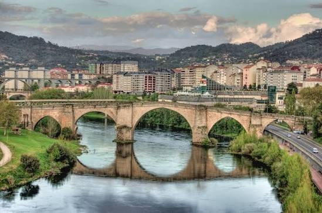

# Ourense
**Ourense** es una hermosa ciudad española situada en la comunidad autónoma de *Galicia*. Es la capital de la provincia homónima y destaca por ser la tercera ciudad gallega más poblada. Es conocida popularmente como *"La Ciudad de las Burgas"* debido a sus famosas fuentes de aguas termales medicinales que brotan en pleno centro urbano.

## Historia
Los orígenes de la ciudad se remontan a la época del **Imperio Romano**, quienes se asentaron en la zona atraídos por la presencia de oro en el río Miño y por las propiedades terapéuticas de sus manantiales termales. Los romanos bautizaron este lugar como *Aquae Urentes* ("aguas ardientes"). Durante la Edad Media, la ciudad se consolidó como un importante punto comercial y de paso dentro del Camino de Santiago, sufriendo diversas invasiones de pueblos suevos y normandos a lo largo de los siglos.

## Características

Ourense posee una identidad única gracias a su combinación de patrimonio histórico, naturaleza y su gran riqueza hidrotermal.

Entre sus características principales destacan:
- **Capital Termal:** Cuenta con un gran caudal de aguas minero-medicinales, destacando las fuentes de As Burgas y los pozos termales al aire libre junto al río Miño (como Outariz o Chavasqueira).
- **Patrimonio Arquitectónico:** Alberga monumentos de gran valor histórico como la Catedral de San Martiño (siglo XII) y el famoso Puente Romano.
- **Gastronomía Tradicional:** Es famosa por sus zonas de vinos y pinchos en el casco histórico (la zona de "Os Viños"), donde se pueden degustar platos típicos como el pulpo á feira y el pan de Cea.
- **Clima de contrastes:** A diferencia de la costa gallega, Ourense tiene un clima más continental, con veranos muy calurosos e inviernos fríos.

## Lugares imprescindibles (Qué visitar)
Si visitas la ciudad por primera vez, estos son los tres lugares que debes ver en orden de importancia:
1. **Las fuentes de As Burgas:** Manantiales en pleno centro donde el agua brota a más de 60 °C.
2. **La Catedral de San Martiño:** Una joya del románico y gótico que esconde el espectacular Pórtico del Paraíso.
3. **El Puente Romano:** El puente histórico que cruza el río Miño y que da identidad a la ciudad.

## Información
A continuación se presenta un resumen de los datos clave de la localidad:

| Elemento | Información |
|---|---|
| **Comunidad Autónoma** | Galicia |
| **Río Principal** | Río Miño |
| **Población** | Aproximadamente 104.000 habitantes |
| **Fiesta Mayor** | Magosto (en noviembre) |

## Enlaces
[Concello de Ourense](https://ourense.gal)

-----------------

> "Ourense es la provincia del agua: la que corre bajo sus puentes, la que brota hirviendo de la tierra y la que se bebe en sus viñedos."